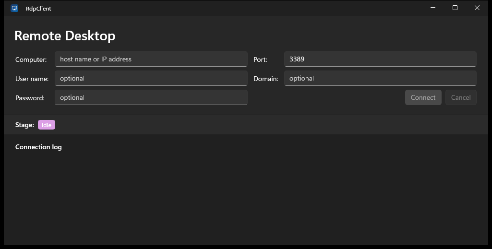

<div align="center">


# RdpClient

**An RDP client built from Microsoft's public Open Specifications.**

[](https://learn.microsoft.com/windows/apps/winui/)
[](https://dotnet.microsoft.com/)
[](LICENSE)

[Documentation](https://adyoi.github.io/RdpClient/) · [Releases](https://github.com/adyoi/RdpClient/releases) · [Issues](https://github.com/adyoi/RdpClient/issues)

</div>

---

## What this is

`RdpClient` is a native Windows remote-desktop client implemented **from the specification**, not
from source code. The RDP protocol is documented publicly by Microsoft as
[MS-RDPBCGR](https://learn.microsoft.com/openspecs/windows_protocols/ms-rdpbcgr/17a977be-ba6e-4624-9a1c-49a4d8313ac2)
and its companion documents, so the client can be written and audited without disassembling
anything.

The goal is a client you control and can read, for interoperability with Windows RDP hosts and
for understanding the protocol itself.

> **Status: connection sequence complete, desktop not yet drawn.** See [Scope](#scope-what-works-and-what-does-not)
> for exactly what is implemented. The client negotiates, authenticates its way
> into a session and completes connection finalization against xrdp, then reads
> the graphics stream - but the drawing orders xrdp sends do not decode, so the
> app still does not display a remote desktop. Input is not implemented.



## Why from the specification

Windows ships `mstsc.exe` and `mstscax.dll`, but neither is documented and both change
every Windows release. Analysis of the shipping client confirms how much is actually involved:

| Measurement | Value | Source |
| --- | ---: | --- |
| `mstscax.dll` size | 8.7 MB | SHA-256 `2fa54a09…` |
| Functions | **22,685** | Ghidra 12.1.4 decompilation |
| Defined strings | **20,552** | Ghidra 12.1.4 decompilation |
| COM interfaces exposed | `IMsRdpClient` 2–9, `IMsRdpClientAdvancedSettings` 2–8, `IMsRdpClientNonScriptable` 2–8 | embedded type library |

Reading the type library alone yields a usable blueprint: `Connect`, `ConnectWithEndpoint`,
`ConnectToAdministerServer`, `ExtendedDisconnectReason`, `RdpFileContents`, `PortablePassword`,
`RdpdrClip*`. Those are the seams a reimplementation needs, and they are all documented too.

See [docs/research.md](docs/research.md) for the analysis and its limitations.

## Scope: what works and what does not

Honesty here matters more than a feature checklist. Every step through connection
finalization is implemented and verified against a live server. Graphics are read
but do not yet decode, and input does not exist.

| Layer | Spec | Status |
| --- | --- | --- |
| X.224 / T.125 connection request | — | **Done** |
| RDP Negotiation (`RDP_NEG_REQ` / `RDP_NEG_RSP`) | 2.2.1.1, 2.2.1.2 | **Done** |
| MCS Connect Initial / Connect Response | 2.2.1.3.4, 2.2.1.3.5 | **Verified against xrdp** |
| GCC client data (`TS_UD_CS_*`) | 2.2.1.3.2–.5 | **Verified against xrdp** |
| Erect Domain / Attach User / Channel Join | 2.2.1.5, .6, .8 | **Verified against xrdp**; replies parsed |
| RSA key exchange, RC4 / AES session keys | 2.2.1.4.3, 5.3.2 | Not started |
| TLS handshake for the External Security Protocol | MS-RDPEA 3.1.5.1 | **Works** (verified) |
| CredSSP / NLA — SPNEGO + NTLM | MS-NLMP, MS-RDPEA | Incomplete; the host now reports `STATUS_LOGON_FAILURE` instead of rejecting the token, so the credentials are what fail |
| Client Info PDU and licensing | 2.2.1.11, 1.3.1.1 | **Verified against xrdp** |
| Capability set exchange | 2.2.7, 2.2.1.13 | **Verified against xrdp** |
| Synchronize / Control / Font List | 2.2.1.14–.18 | **Verified against xrdp** |
| Graphics: reading updates, bitmap path | 2.2.9.1.1.3 | **Read and dispatched, not verified** — no live bitmap update has been decoded |
| Graphics: drawing orders | MS-RDPEGDI 2.2.2.2.1 | **Implemented, does not decode xrdp's stream** |
| Keyboard and pointer input | 2.2.8 | Not started |
| Virtual channel data (clipboard, drive, audio) | 2.2.6 | Not started |

Against a **Windows** host the client negotiates, completes TLS, and is then
selected for CredSSP, which authenticates with NTLM - not implemented yet. The
client stops there and says why. Windows also refuses `PROTOCOL_SSL` on its own
with failure code 5, `SSL_REQUIRED_BY_SERVER`, because it wants NLA, so that host
cannot exercise anything past TLS.

Against **xrdp** the client completes the entire connection sequence. The server
parses the Connect Initial and its client data blocks, answers the Connect
Response, attaches the user, accepts all ten Channel Join Requests, reads the
Client Info PDU and answers with Licensing and Demand Active, accepts the
Confirm Active, and finally answers the client's Synchronize, Control and Font
List PDUs with its own Synchronize, Control (Cooperate and Granted Control) and
Font Map. Every one of those replies is read and parsed, so the reported result
reflects what the server actually said. See
[the changelog](CHANGELOG.md) for the byte-level record and
[the xrdp log excerpt](docs/wsl-rdp-lab.md#10-read-the-servers-log-before-theorising).

After that the client reads the graphics stream - and stops short of a picture.
xrdp sends Orders Updates and the decoder cannot walk them, so the run ends with
`1 graphics update(s) read, 0 applied` and no desktop. The measurements that pin
down why are in [AGENTS.md](AGENTS.md#the-order-stream-from-xrdp-does-not-decode-yet).

### What stands between this and the login screen

The login screen is not one feature; it sits behind the rest of the protocol.
Reaching it requires, in dependency order:

| Step | Spec | State |
| --- | --- | --- |
| X.224 negotiation | 2.2.1.1 | Done |
| TLS handshake | MS-RDPEA 3.1.5.1 | Done |
| SPNEGO + NTLM | MS-NLMP | Incomplete — host reports `STATUS_LOGON_FAILURE` |
| CredSSP renegotiation | MS-RDPEA 3.2.1.5.1.5 | Written, not yet reachable |
| RSA key exchange, session keys, MCS encryption | MS-RDPBCGR 5.3.2 | Not started |
| Capability exchange (`Demand Active` / `Confirm Active`) | 2.2.7 | **Done, verified against xrdp** |
| Connection finalization | 2.2.1.14–.18 | **Done, verified against xrdp** |
| Drawing order decoding | MS-RDPEGDI 2.2.2.2.1 | Implemented, does not decode the stream yet |
| Bitmap rendering | 2.2.9 | Read and dispatched, never verified against a live server |
| Keyboard and pointer input | 2.2.8 | Not started |

## Prebuilt binaries

Release assets carry a self-contained probe and a Release build of the app:

| File | Size | Notes |
| --- | --- | --- |
| `rdpprobe.exe` | ~70 MB | Self-contained, single file. No .NET runtime needed. |
| `RdpClient.exe` | ~0.5 MB | The WinUI app. Needs the Windows App SDK runtime. |

```powershell
$env:RDP_PASSWORD = '...'
.\rdpprobe.exe --host 192.0.2.10 --user alice --hex
```

`rdpprobe` is the practical way to exercise the protocol; the WinUI app needs
package identity, so build and run it with `winapp run` instead.

## Platform support

**Windows only**, on x64, ARM64 and x86.

This is a hard platform limit, not a roadmap item: **WinUI 3 ships only for Windows**. There is
no macOS or Linux build of this app, and adding one would mean replacing the entire UI layer.

The protocol core (`RdpClient.Protocol`) is deliberately free of any UI dependency and targets
plain .NET, so it can be reused from a cross-platform front end if one is ever wanted. Only
`RdpClient.App` is Windows-bound.

| Architecture | Build | Notes |
| --- | --- | --- |
| `x64` | Supported | Windows 10 1809+ |
| `ARM64` | Supported | Native |
| `x86` | Supported | 32-bit; Windows on ARM runs it emulated |

## Requirements

- Windows 10 1809 (build 17763) or later
- [.NET SDK 10.0](https://dotnet.microsoft.com/download) to build
- [WinApp CLI](https://learn.microsoft.com/windows/apps/develop/cli/) (`winget install Microsoft.WinAppCLI`) to run

## Build and run

```powershell
git clone https://github.com/adyoi/RdpClient.git
cd RdpClient

dotnet build                                   # default platform
winapp run                                    # launch with package identity
```

Build a specific architecture:

```powershell
dotnet build -p:Platform=x64
dotnet build -p:Platform=ARM64
dotnet build -p:Platform=x86
```

### Probe the handshake from a terminal

The protocol core ships with a console harness, so the connection sequence can be exercised
without the GUI:

```powershell
dotnet run --project src/RdpClient.Cli -- --host 192.0.2.10 --port 3389
```

Against a **Windows** host with NLA enabled, negotiation and TLS both complete
and the client then stops where the unimplemented part begins:

```text
18:44:17.885  info    negotiated version 0x00000008, SelectedProtocol 0x00000008
18:44:17.886  info    External Security Protocol: CredSSP (TLS + SPNEGO/NTLM)
18:44:17.886  info    starting TLS handshake, SNI 'TERMSRV/127.0.0.1'
18:44:17.958  info    Tls13, subject 'CN=runnervm0xl3a' issued by 'CN=runnervm0xl3a'
18:44:17.958  error   the server selected CredSSP, which authenticates with NTLM,
                      but no user name was supplied

RESULT: failed - the server selected CredSSP, ...
```

`--tls-only` is refused by that host with negotiation failure code 5,
`SSL_REQUIRED_BY_SERVER`, because it wants NLA. So a Windows host cannot be used
to check anything past TLS.

Against **xrdp** (`--tls-only`, port 3390) the client gets through MCS, which is
what makes that server worth having:

```text
18:55:05.168  info    negotiated version 0x00000001, SelectedProtocol 0x00000001
18:55:05.273  info    Tls13, subject 'CN=runnervm0xl3a.localdomain' (self-signed certificate accepted; ...)
18:55:05.290  info    sent MCS Connect Initial (561 bytes)
18:55:05.290  info    MCS accepted (conference 0), UserID 31219, ServerNodeID 31219
18:55:05.453  info    sent Erect Domain Request (12 bytes)
18:55:05.453  info    sent Attach User Request (8 bytes)
18:55:05.497  info    attached as MCS user 1012
18:55:05.497  info    joined MCS channel 1003

RESULT: MCS channel joined.
```

Those last two lines are read from the server's own Confirm PDUs, not assumed.
The session then stops, because the next PDU is the Demand Active and the
capability exchange is not implemented - so no desktop is displayed.

## Project layout

```text
src/
  RdpClient.Protocol/   Protocol core. No UI dependency, plain .NET.
    ByteCodec.cs          Little-endian reader/writer; the TPKT length is big-endian
    Rdp.cs                Constants transcribed from MS-RDPBCGR
    Negotiation.cs        X.224 / T.125 and RDP_NEG_REQ / RDP_NEG_RSP
    Mcs.cs                Connect Initial/Response, Erect Domain, Attach User, join
    Asn1.cs               BER and PER primitives; big-endian integers, split tags
    ClientPdu.cs          TS_UD_CS_CORE / SECURITY / NET / CLUSTER / USER
    RdpConnection.cs      Connection sequencing over TCP
  RdpClient/            WinUI 3 front end (Windows only)
  RdpClient.Cli/        Console handshake harness
tests/
  RdpClient.Protocol.Tests/
docs/                   Protocol notes, research, architecture
```

## Documentation

| Document | Contents |
| --- | --- |
| [docs/protocol.md](docs/protocol.md) | Field-by-field notes on each PDU, with spec sections |
| [docs/architecture.md](docs/architecture.md) | Project structure and design decisions |
| [docs/research.md](docs/research.md) | Analysis of `mstsc.exe` / `mstscax.dll` and what it revealed |
| [docs/wsl-rdp-lab.md](docs/wsl-rdp-lab.md) | Standing up xrdp in WSL as a second server to test against |
| [AGENTS.md](AGENTS.md) | Working notes: the honest status table, the wire-format invariants, and the measurements behind every open defect |
| [CHANGELOG.md](CHANGELOG.md) | Release history |

## Security

The classic-RDP user data block sends a password as UTF-16 **in the clear**.
MS-RDPBCGR does not define that block at all - it predates the specification,
and xrdp answers `TS_UD_HEADER type 0xc00e is unknown (ignored)` - so it is off
by default and reachable only through the explicit `--classic-user` flag or the
`SendClassicUserBlock` option.

Even where a server accepts it, on any untrusted network that is unacceptable.
CredSSP/NLA is not implemented yet for exactly this reason — until it is, only use
this against hosts you control or over a trusted, encrypted transport.

The TLS certificate is accepted unconditionally, because an RDP host presents a
self-signed certificate issued for `TERMSRV/<host>` and RDP does not
chain-validate it. The handshake log reports the subject and issuer of whatever
was accepted.

## Contributing

Issues and pull requests are welcome. Please read [CONTRIBUTING.md](CONTRIBUTING.md) first.

An agent working in this repository should also read [AGENTS.md](AGENTS.md). The
`rdp-wire-format` skill under `.agent/skills/` covers the protocol work: how to
verify a PDU against a real client, how to read a connection reset, and which
Windows binary to decompile for a given question.

## License

MIT. See [LICENSE](LICENSE).

RDP is a documented Microsoft protocol; this project contains no Microsoft code. You are
responsible for complying with the licence terms of any RDP host you connect to.